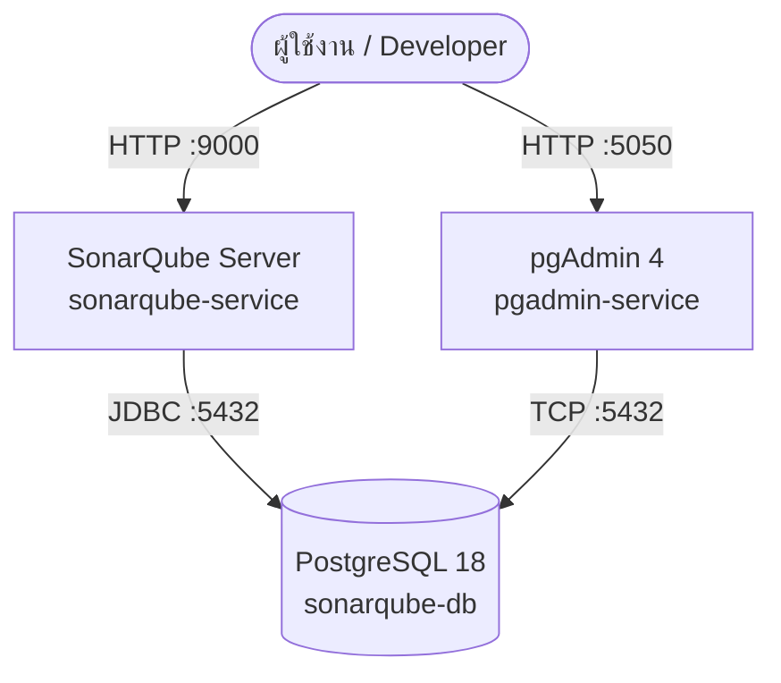

# SonarQube Community Edition with PostgreSQL & pgAdmin

ชุดสภาพแวดล้อมสำหรับรัน **SonarQube Community Edition** พร้อมฐานข้อมูล **PostgreSQL** และเว็บแอดมิน **pgAdmin 4** ด้วย Docker Compose

---

## สถาปัตยกรรมระบบ (Architecture)

ระบบประกอบด้วย 3 คอนเทนเนอร์หลักที่เชื่อมต่อกันผ่าน Docker Bridge Network (`sonarqube-network`):



1. **`sonarqube` (`sonarqube-service`)**: SonarQube Server สำหรับวิเคราะห์คุณภาพและช่องโหว่ของโค้ด (Static Code Analysis)
2. **`db` (`sonarqube-db`)**: PostgreSQL สำหรับจัดเก็บข้อมูลโครงการ กฎการวิเคราะห์ และประวัติผลการตรวจสอบ
3. **`pgadmin` (`pgadmin-service`)**: เว็บ UI สำหรับดูแลจัดการฐานข้อมูล PostgreSQL

---

## ข้อมูลการเข้าใช้งาน (Credentials & Endpoints)

| บริการ (Service) | URL / Host | Username / Email | Password | รายละเอียดเพิ่มเติม |
| :--- | :--- | :--- | :--- | :--- |
| **SonarQube Web UI** | [http://localhost:9000](http://localhost:9000) | `admin` | `admin` | ระบบจะบังคับให้เปลี่ยนรหัสผ่านเมื่อเข้าสู่ระบบครั้งแรก |
| **pgAdmin 4 Web UI** | [http://localhost:5050](http://localhost:5050) | `admin@example.com` | `admin` | เว็บจัดการฐานข้อมูล |
| **PostgreSQL** | `db:5432` *(ภายใน network)* | `sonarqube` | `P@ssw0rd!` | Database: `sonarqube` |

---

## ข้อกำหนดก่อนการติดตั้ง (Prerequisites)

SonarQube มีส่วนประกอบภายในคือ Elasticsearch ซึ่งมีข้อกำหนดเฉพาะเกี่ยวกับหน่วยความจำและ Kernel settings ของระบบปฏิบัติการ:

### 1. หน่วยความจำ (Memory Requirements)
- คอนเทนเนอร์ SonarQube กำหนด Heap Memory สำหรับ Web Server (`-Xmx2048m`) และ Compute Engine (`-Xmx2048m`) รวมกับ Elasticsearch และ PostgreSQL
- **แนะนำให้จัดสรร RAM ให้กับ Docker อย่างน้อย 6 GB – 8 GB**

### 2. การตั้งค่า Kernel Host (สำคัญมากสำหรับ Elasticsearch)

#### สำหรับ Linux:
รันคำสั่งต่อไปนี้บน Host:
```bash
sudo sysctl -w vm.max_map_count=262144
sudo sysctl -w fs.file-max=131072
```
บันทึกการตั้งค่าถาวรใน `/etc/sysctl.conf`:
```ini
vm.max_map_count=262144
fs.file-max=131072
```

#### สำหรับ Windows (Docker Desktop บน WSL 2):
รันคำสั่งใน PowerShell:
```powershell
wsl -d docker-desktop sysctl -w vm.max_map_count=262144
```
หรือสร้าง/แก้ไขไฟล์ `%USERPROFILE%\.wslconfig` เพื่อให้มีผลทุกครั้งที่เปิดเครื่อง:
```ini
[wsl2]
kernelCommandLine = "sysctl.vm.max_map_count=262144"
```

---

## โครงสร้างโฟลเดอร์และการเก็บรักษาข้อมูล (Data Persistence)

```
.
├── docker-compose.yml          # ไฟล์คอนฟิก Docker Compose
├── readme.md                   # เอกสารประกอบการใช้งาน
├── .gitignore                  # ไม่นำโฟลเดอร์ data/logs ขึ้น Git
├── postgres/                   # ข้อมูลฐานข้อมูล PostgreSQL (/var/lib/postgresql)
└── sonarqube/
    ├── data/                   # ข้อมูล Elasticsearch & runtime index (/opt/sonarqube/data)
    ├── extensions/             # ปลั๊กอินเสริมและ Custom rules (/opt/sonarqube/extensions)
    └── logs/                   # บันทึกการทำงานระบบ Web, CE, ES, Access (/opt/sonarqube/logs)
```

> [!NOTE]
> โฟลเดอร์ `postgres/` และ `sonarqube/` ถูก ignore ไว้ใน `.gitignore` เพื่อความปลอดภัยและไม่ให้ไฟล์ฐานข้อมูล/index ขนาดใหญ่ถูก commit เข้าสู่ version control

---

## ขั้นตอนการใช้งาน (Getting Started)

### 1. เริ่มต้นการทำงาน (Start Services)
รันคำสั่งเพื่อดาวน์โหลด Image และเริ่มทำงานในโหมด Background:
```bash
docker compose up -d
```

### 2. ตรวจสอบสถานะคอนเทนเนอร์ (Check Status)
```bash
docker compose ps
```
เมื่อเริ่มต้นระบบ SonarQube จะใช้เวลาประมาณ 1–2 นาทีในการเตรียม Elasticsearch และ Schema ของฐานข้อมูล:
- สถานะของ `sonarqube-service` จะแสดงเป็น `(health: starting)` จนกระทั่งระบบพร้อมใช้งานจึงเปลี่ยนเป็น `(healthy)`

สามารถตรวจสอบสถานะ API ได้โดยตรง:
```bash
curl http://localhost:9000/api/system/status
```
*(เมื่อพร้อมใช้งานจะตอบกลับ `{"id":"...","version":"...","status":"UP"}`)*

### 3. ดู Log การทำงาน (View Logs)
```bash
# ดู log ทั้งหมด
docker compose logs -f

# ดูเฉพาะ SonarQube
docker compose logs -f sonarqube

# ดูเฉพาะ Database
docker compose logs -f db
```

### 4. หยุดการทำงาน (Stop Services)
```bash
# หยุดการทำงานโดยเก็บข้อมูลไว้
docker compose down

# หยุดและลบ volume ทั้งหมด (คำเตือน: ข้อมูลทั้งหมดจะสูญหาย)
docker compose down -v
```

---

## การเชื่อมต่อ pgAdmin เข้ากับ PostgreSQL

1. เปิดเบราว์เซอร์ไปที่ [http://localhost:5050](http://localhost:5050)
2. เข้าสู่ระบบด้วย:
   - **Email**: `admin@example.com`
   - **Password**: `admin`
3. คลิกขวาที่ **Servers** > **Register** > **Server...**
4. ที่แท็บ **General**:
   - **Name**: `SonarQube DB`
5. ที่แท็บ **Connection**:
   - **Host name/address**: `db`
   - **Port**: `5432`
   - **Maintenance database**: `sonarqube`
   - **Username**: `sonarqube`
   - **Password**: `P@ssw0rd!`
6. คลิก **Save**

---

## ข้อแนะนำด้านความปลอดภัยสำหรับ Production

> [!WARNING]
> การตั้งค่าในปัจจุบันเหมาะสำหรับสภาพแวดล้อม Development / Local เท่านั้น หากต้องการนำไปใช้งานจริงบน Server แนะนำปรับปรุงดังนี้:

1. **ใช้ไฟล์ `.env` แยกสำหรับรหัสผ่าน:**
   ไม่ควร Hardcode รหัสผ่านใน `docker-compose.yml` โดยตรง ควรกำหนดผ่าน Environment file
2. **เปลี่ยนรหัสผ่านเริ่มต้น:**
   - เปลี่ยนรหัสผ่าน `admin` ของ SonarQube ทันที
   - เปลี่ยนรหัสผ่าน PostgreSQL และ pgAdmin
3. **กำหนดเวอร์ชัน Image ที่แน่นอน (Pin Version):**
   หลีกเลี่ยงการใช้แท็ก `:latest` สำหรับฐานข้อมูลหรือระบบหลัก ให้ระบุเวอร์ชันเจาะจง เช่น `sonarqube:10.7-community` และ `postgres:17` หรือ `postgres:18`
4. **จำกัด Port Binding:**
   หากรันผ่าน Reverse Proxy (เช่น Nginx / Traefik) ให้ผูกพอร์ตเฉพาะ `127.0.0.1:9000:9000` เพื่อป้องกันการเข้าถึงจากภายนอกโดยตรง

---

## การแก้ไขปัญหาเบื้องต้น (Troubleshooting)

### ปัญหาที่ 1: SonarQube หยุดทำงานทันทีหลังสตาร์ท (Exit 143 หรือ 78)
- **สาเหตุ:** `vm.max_map_count` ของ Host ต่ำเกินไป ทำให้ Elasticsearch ทำงานไม่ได้
- **วิธีแก้:** ตรวจสอบและตั้งค่า `sysctl -w vm.max_map_count=262144` ตามขั้นตอนในหัวข้อ Prerequisites

### ปัญหาที่ 2: SonarQube แจ้งเตือน `Fail to connect to database`
- **สาเหตุ:** คอนเทนเนอร์ฐานข้อมูล `db` ยังเตรียมตัวไม่เสร็จ หรือ Network ขัดข้อง
- **วิธีแก้:** ใน `docker-compose.yml` มีการตั้งค่า `condition: service_healthy` อยู่แล้ว ตรวจสอบว่า `sonarqube-db` สามารถรัน healthcheck ผ่านหรือไม่ด้วยคำสั่ง `docker compose ps`

### ปัญหาที่ 3: ข้อมูลหรือปลั๊กอินหายหลัง Restart
- **สาเหตุ:** Volume path ไม่ถูกต้อง
- **หมายเหตุ:** ใน `docker-compose.yml` ฉบับปรับปรุง ได้แก้ไข Path ของ Data เป็น `./sonarqube/data:/opt/sonarqube/data` เรียบร้อยแล้ว ซึ่งจะจัดเก็บ Index และข้อมูลต่างๆ ไว้อย่างถูกต้องบน Host
